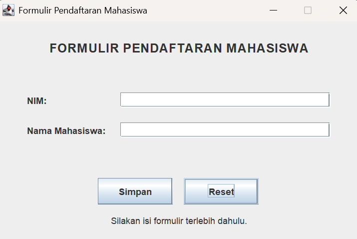
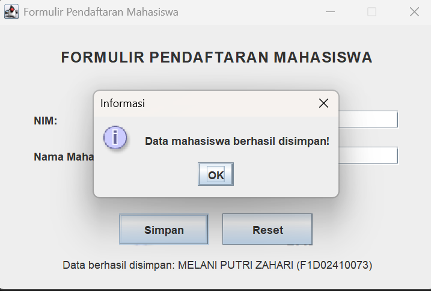

## Mata Kuliah: Pemrograman Berorientasi Objek (PBO)
## Nama Aplikasi: Formulir Pendaftaran Mahasiswa

## 1. Deskripsi Aplikasi
Aplikasi Formulir Pendaftaran Mahasiswa merupakan program berbasis Graphical User Interface (GUI)yang dibuat menggunakan Java Swing. Aplikasi ini digunakan untuk memasukkan NIM dan
nama mahasiswa. Pengguna dapat menekan tombol Simpan untuk menampilkan data yang telah diinput dan tombol Reset untuk mengosongkan formulir.

## 2. Implementasi Lima Komponen Utama GUI

### A. Top-Level Container Class

Class yang digunakan adalah JFrame.

JFrame berfungsi sebagai jendela utama aplikasi
yang menampung seluruh komponen GUI.

Implementasi:
- setTitle()
- setSize()
- setDefaultCloseOperation()
- setLocationRelativeTo()

### B. Intermediate Container Class

Class yang digunakan adalah JPanel.

JPanel berfungsi untuk mengelompokkan komponen
GUI agar susunan aplikasi lebih terstruktur.

Aplikasi menggunakan empat JPanel:
- panelUtama
- panelForm
- panelBawah
- panelTombol

### C. Atomic Component Class

Komponen yang digunakan:

1. JLabel: Menampilkan judul, keterangan NIM, nama mahasiswa, dan informasi hasil.
2. JTextField: Menerima input NIM dan nama mahasiswa.
3. JButton: Menjalankan perintah Simpan dan Reset.

### D. Layout Classes

Aplikasi menggunakan tiga jenis Layout Manager:

1. BorderLayout
   Digunakan untuk mengatur posisi panel utama dan panel bagian bawah.

2. GridBagLayout
   Digunakan untuk menyusun label dan kolom input formulir secara terstruktur.

3. FlowLayout
   Digunakan untuk mengatur posisi tombol Simpan dan Reset secara horizontal.

### E. Event Listener

Aplikasi menggunakan interface ActionListener.

Event Listener digunakan untuk menangani interaksi pengguna terhadap tombol Simpan dan Reset.

Method actionPerformed(ActionEvent e) di-override untuk menentukan tindakan berdasarkan tombol yang ditekan oleh pengguna.

## 3. Dokumentasi Screenshot

### A. Tampilan Awal Aplikasi

Berikut merupakan tampilan awal aplikasi Formulir Pendaftaran Mahasiswa sebelum pengguna memasukkan data.

### B. Hasil Pengujian Aplikasi

Berikut merupakan tampilan aplikasi setelah pengguna memasukkan NIM dan nama mahasiswa, kemudian menekan tombol Simpan.

